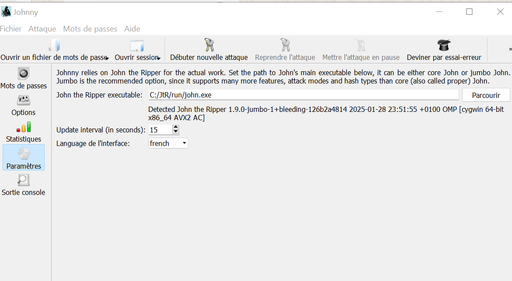
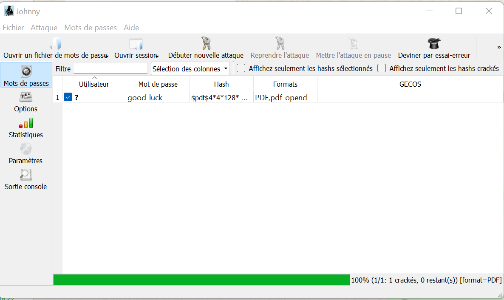
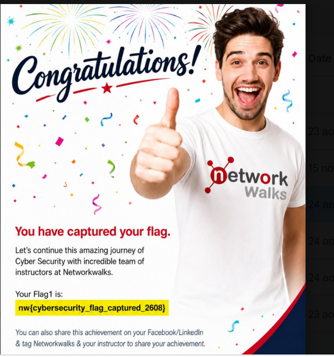
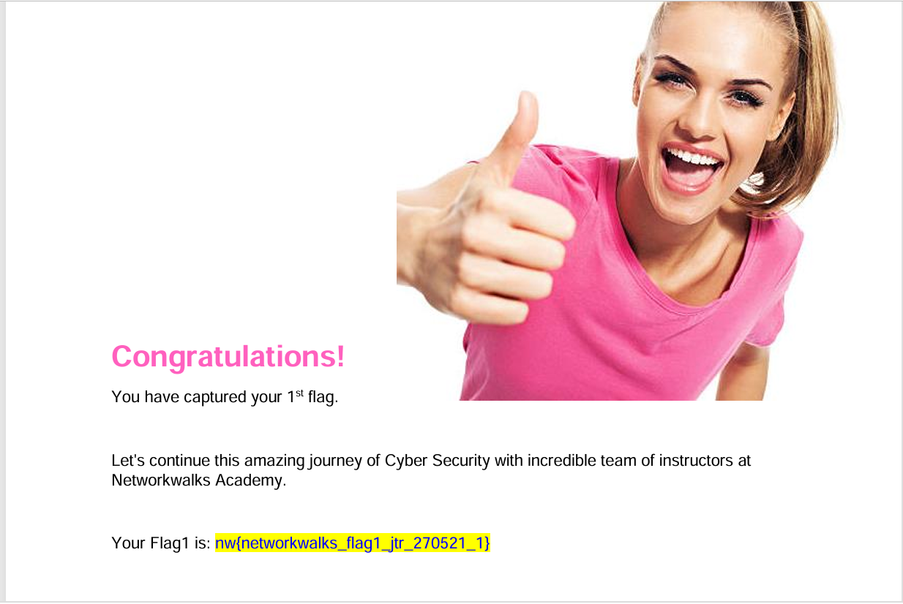

# NETWORKWALKS-B084_-Week3-Cybesecurity_Setup
Password cracking with John the Ripper and Johnny GUI on Windows/NW tools

# Project 1:
Password cracking with John the Ripper and Johnny GUI on Windows

This project documents a practical password auditing exercise carried out during my third week of cybersecurity internship at Networkwalks.
The objective was to explore how John the Ripper can be used to recover the password of a password-protected PDF document from its extracted hash.

# Tools and Technologies

Operating System: Windows

John the Ripper: Password auditing tool

Johnny GUI: Graphical interface for John the Ripper

PDF Hash Extractor: Online tool used to extract the PDF hash

Text Editor: Used to save the extracted hash in a TXT file

# Methodology

# 1. Downloading John the Ripper

Downloaded John the Ripper from the official Openwall website.
https://www.openwall.com/john/
or https://distro.ibiblio.org/openwall/projects/john/1.9.0/

# 2. Installing and Configuring Johnny GUI

- Downloaded and installed Johnny GUI.
https://openwall.info/wiki/john/johnny

- Opened the settings browser and added the path to john.exe to connect Johnny to the John the Ripper engine.

# 3. Extracting the PDF Hash

Used an online PDF hash extraction tool to obtain the hash of the password-protected document.
https://www.onlinehashcrack.com/tools-pdf-hash-extractor.php
The extracted hash was copied and saved in a .txt file.

# 4. Loading the Hash into Johnny

Opened Johnny GUI and selected Open File.
Imported the TXT file containing the extracted hash.

# 5. Starting the Password Audit

Selected Start New Attack to launch the password auditing process.

# 6. Verifying the Result

The password was recovered within a few seconds.
The recovered password was then tested on the original PDF document, successfully confirming the result.

# Learning Outcomes

- Through this practical exercise, I learned how to:

- Install and configure John the Ripper on Windows.

- Use Johnny GUI as a graphical interface.

- Understand the role of hashes in password auditing.

- Extract a PDF password hash.

- Perform a password recovery test in an authorized laboratory environment.

- Verify the results of a password auditing exercise.

# projet 2: PDF Hash Analysis Using Networkwalks Tools

For this second practical exercise, I used two tools provided by Networkwalks to explore another approach to PDF password security testing.

# Tools Used

Networkwalks Hash Calculator

Networkwalks Password Cracker

# Exercise Overview

The exercise involved a second password-protected PDF document.

The following activities were performed:

- Used the Networkwalks Hash Calculator to analyze the PDF document and obtain its hash information.
https://networkwalks.com/hash-calculator/

- Explored the Networkwalks Password Cracker to understand its approach to password recovery.
  https://networkwalks.com/password-cracker/

- Observed the tool's output and documented the results of the exercise.
  

# Learning Outcomes

This second exercise allowed me to:

Discover additional password security testing tools.

Understand the relationship between PDF documents and password hashes.

Compare different approaches to password auditing.

Explore the importance of password strength and document prot
